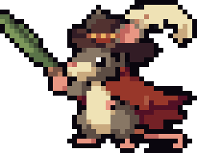
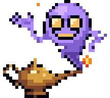
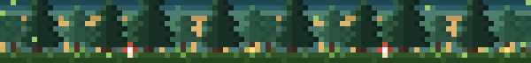
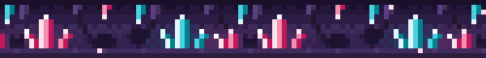
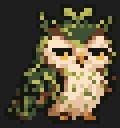
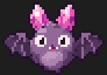
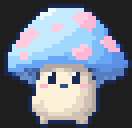

# Modster Hunter

**Catch Modsters while you wait for Claude.**

<table align="center">
  <tr>
    <td align="center" width="50%">
      <br>
      <b>Musketail</b><br>
      <sub>It picks a fresh leaf cloak each season. Autumn ones are its favorite, because red looks heroic.</sub>
    </td>
    <td align="center" width="50%">
      <br>
      <b>Lamparito</b><br>
      <sub>A spirit of hot smoke that sleeps in a brass lamp half-buried in the sand. It offers every traveler three wishes and twists every one of them. Its grin is the only part of it that is never smoke.</sub>
    </td>
  </tr>
</table>

Modster Hunter is a [Claude Code mod](https://code.claude.com/docs/en/plugins/mods):
a tiny collecting game that lives in your terminal, right above the prompt.

You ask Claude for something. While it works, a wild Modster wanders into view.
Press `1` to throw. You get a few tries before it gets bored and leaves. When
Claude is done, the game steps aside and you get back to work.

## Biomes

Each session drops you into one biome at random, each with its own Modsters:

🌲 **Whispering Forest**: tall pines, soft moss, something rustling.



💎 **Crystal Grotto**: whisper here and the crystals whisper back, a little out of tune.



Two more are out there for you to find.

## Catchers

Every throw plays a catcher. Pick yours in `/modsters`, on the Catchers tab:

<table align="center">
  <tr>
    <td align="center"><br><b>Seed pod</b></td>
    <td align="center"><br><b>Lantern</b></td>
    <td align="center"><br><b>Puzzle Cube</b></td>
  </tr>
</table>

## Install

You need Claude Code **v2.1.292 or later** (`claude --version`), in a terminal.

```bash
claude plugin install modster-hunter --marketplace danielpg95/modster-hunter
```

Or, inside a session: `/plugin marketplace add danielpg95/modster-hunter`, then
`/plugin install modster-hunter@modster-hunter`. Start a new session and ask
Claude for anything. `/modsters stop` turns the game off.

## How to play

| Key or command | What it does |
| --- | --- |
| `/modsters hunt` | Start hunting: Modsters show up while Claude works |
| `/modsters stop` | Stop hunting |
| `1` / `2` | Throw / run while a Modster is up |
| `/modsters` | Your collection, the biomes, stats, catchers and settings |
| `/modsters pane` | A bigger encounter pane, for a better view |
| `/modsters settings` | Every option: Auto start, where the game shows, and more |
| `/modsters reload` | Load your own Modsters after you add or change them |
| `/modsters help` | Every command |

## Contributing

New hands are welcome, **especially pixel artists**. Pitch a Modster or biome in
an issue, playtest, report bugs, or pick up a task from the
[roadmap](docs/ROADMAP.md). [CONTRIBUTING.md](CONTRIBUTING.md) explains the
routine. If you use Claude Code, open the repo and start with the
`start-session` skill.

To run from source:

```bash
git clone https://github.com/danielpg95/modster-hunter.git
cd modster-hunter
claude --plugin-dir ./plugin
```

## License

Code is under the [MIT License](LICENSE). Built-in art and sounds are under
[CC BY 4.0](https://creativecommons.org/licenses/by/4.0/), credited per asset in
[`plugin/content/CREDITS.md`](plugin/content/CREDITS.md)
([decision 0011](docs/decisions/0011-license.md)).
