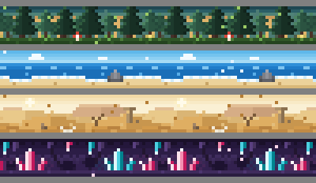
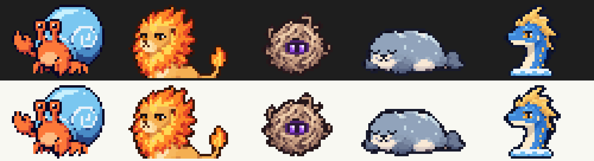
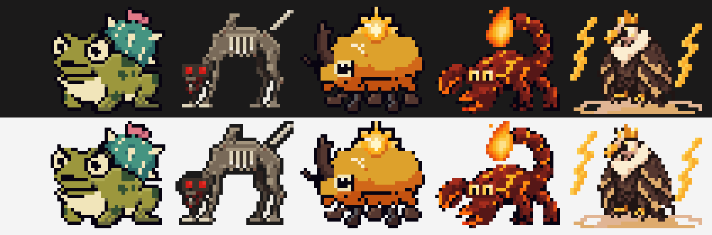
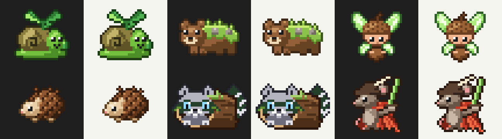

# Modster Hunter

**Catch Modsters while you wait for Claude.**

<p align="center">
  
</p>

Modster Hunter is a [Claude Code mod](https://code.claude.com/docs/en/plugins/mods):
a tiny collecting game that lives in your terminal, right above the prompt.

You ask Claude for something. While it works, a wild Modster wanders into view.
Press `1` to throw. You get a few tries before it gets bored and leaves. When
Claude is done, the game steps aside and you get back to work.

That's it. No grinding, no timers to babysit, nothing that steals your
keystrokes. Just something to catch while you wait for the tests to run.

## Meet some Modsters

There are **31 Modsters** across **4 biomes**, from common critters to
legendaries you'll be lucky to see once. Every one is hand-drawn pixel art with
its own idle animation and dex entry.

<p align="center">
  
</p>

> **Crabbit** lives in a shell three sizes too big. Says it'll grow into it.
>
> **Flopple** naps on warm rocks until the tide carries it off. Then naps in the water.

<p align="center">
  
</p>

> **Lamparito:** Rub the lamp and it grants one wish: to be left alone.
>
> **Reyrayo:** Every storm in the desert answers to it. Most of them are afraid to.

<p align="center">
  
</p>

| Biome | What you'll find |
| --- | --- |
| 🌲 **Whispering Forest** | Tall pines, soft moss, something rustling. |
| 🌊 **Saltbreeze Bay** | The tide comes in, the tide goes out, and something always stays behind. |
| 🏜️ **Dustwind Expanse** | Endless sand where the wind never stops talking. |
| 💎 **Crystal Grotto** | Whisper here and the crystals whisper back, a little out of tune. |

Each session drops you into one biome at random, so you never know who's out
there today.

## What you get

- **A band above the prompt** where Modsters show up while Claude works.
- **`/modsters`** opens your collection: every Modster you've caught, the biomes,
  your stats and settings.
- **`/modsters hunt`** opens a bigger encounter pane, if you'd like a better view.
- **Your own Modsters.** Ask Claude to "make me a Modster" and the mod's
  `create-modster-content` skill designs one with you, sprite included. You can
  also switch off the built-in biomes and play only with yours.
- **Quiet by design.** Fully offline: no network, no model calls, no telemetry.
  It never opens a pane on its own and never takes your keystrokes.

## Try it

Modster Hunter isn't on the plugin marketplace yet (that comes with v1.0). Until
then, run it from source:

```bash
git clone https://github.com/danielpg95/modster-hunter.git
cd modster-hunter
claude --plugin-dir ./plugin
```

Then ask Claude for anything and watch the band above the prompt. Type
`/modsters` to see what you've caught.

**You need** Claude Code **v2.1.287 or later** (`claude --version`), running in
a terminal. Desktop app support is planned.

## Contributing

Modster Hunter is built by a small group of people, mostly pairing with
Claude Code. New hands are very welcome, **especially pixel artists**.

Ways to help:

- **Draw or pitch a Modster or biome.** Open a "New Modster or biome idea"
  issue, or add one yourself with the `add-modster` and `add-biome` skills.
- **Playtest** and tell us what felt good or annoying in an issue.
- **Report a bug** with the bug template.
- **Pick up a task** from the [roadmap](docs/ROADMAP.md).
  `node tools/check-tracking.mjs --next` lists the ones you can claim right now.

We keep a simple routine so everyone stays on the same track: claim a task on
the [workboard](docs/WORKBOARD.md), work on a branch, leave a handoff note, open
a PR. [CONTRIBUTING.md](CONTRIBUTING.md) walks through it.

If you use Claude Code, just open the repo. It reads [CLAUDE.md](CLAUDE.md),
and the contributor skills in `.claude/skills/` guide you through each step.
Start with `start-session`. No Claude Code? The skills are plain Markdown and
work as step-by-step guides.

Useful docs: [architecture](docs/ARCHITECTURE.md),
[development](docs/DEVELOPMENT.md), [content format](docs/CONTENT_FORMAT.md)
and the [decisions](docs/decisions/) behind how the game works.

## License

Code is under the [MIT License](LICENSE). Built-in art and sounds are under
[CC BY 4.0](https://creativecommons.org/licenses/by/4.0/), credited per asset in
[`plugin/content/CREDITS.md`](plugin/content/CREDITS.md)
([decision 0011](docs/decisions/0011-license.md)).
